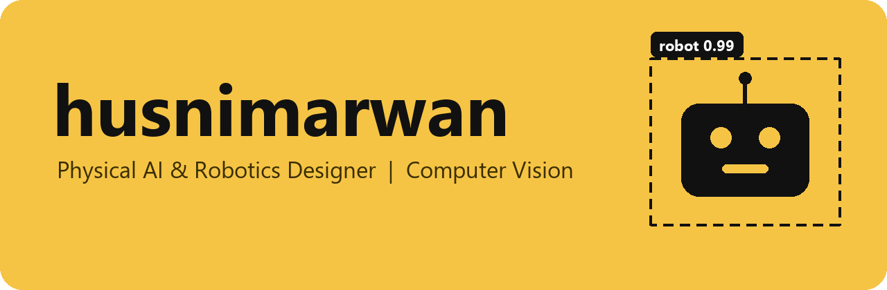

<picture>
  <source media="(prefers-color-scheme: dark)" srcset="assets/banner-dark.png">
  
</picture>

### Hi there 👋

Saya **Husni Marwan** — Physical AI & Robotics Designer dengan minat besar di **Computer Vision**.
Suka membangun hal yang mempertemukan persepsi mesin dengan dunia nyata: robotika, deteksi
objek, sampai tool vision berbasis web yang gampang dipakai siapa saja.

- 🔭 Sedang mengerjakan: **machine-vision** — web app deteksi objek (gambar, video, kamera, URL) dengan YOLO + Flask
- 🧠 Fokus: object detection, robot perception, real-time inference
- 🛠️ Stack: Python · PyTorch · OpenCV · Ultralytics YOLO · Flask · JavaScript
- 🌐 Website: [husnimarwan.com](https://husnimarwan.com)
- 📷 Instagram: [@husnimarwan](https://instagram.com/husnimarwan)

#### Proyek pilihan

| Repo | Deskripsi |
| --- | --- |
| [machine-vision](https://github.com/husnimarwan/machine-vision) | Deteksi objek YOLO dari gambar, video, kamera, dan URL (YouTube / IP camera) — Flask + vanilla JS |
